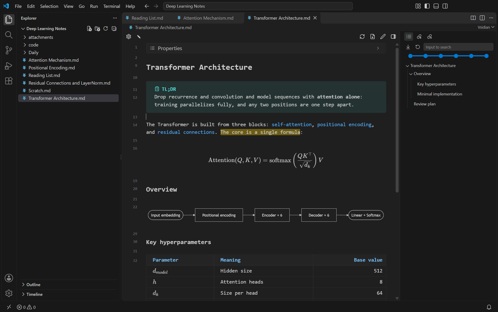
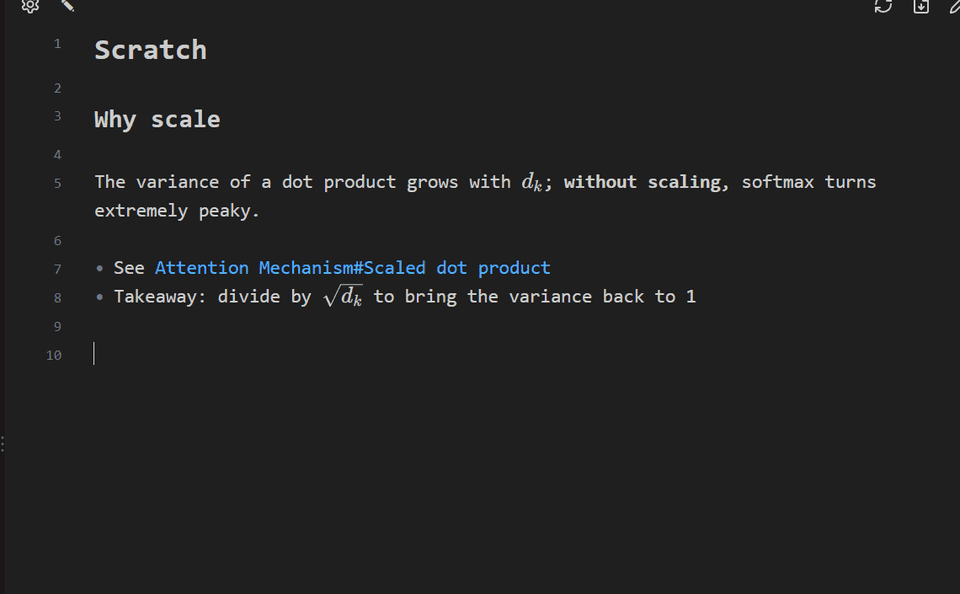
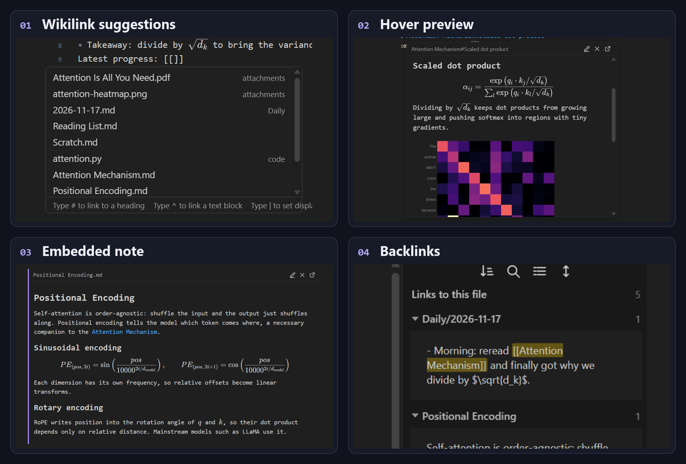
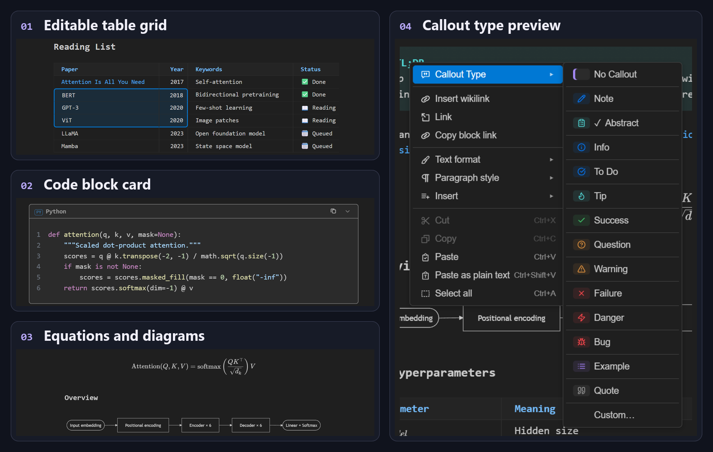
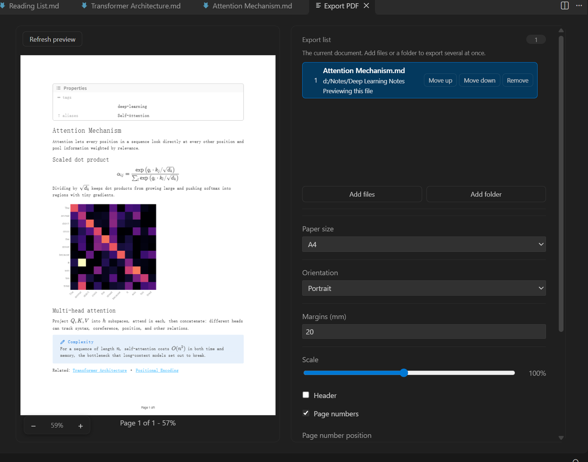
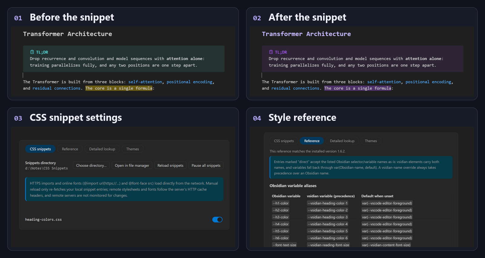

<div align="center">


# Vsidian

**Write Markdown like Obsidian, without leaving VS Code**

[](https://marketplace.visualstudio.com/items?itemName=onegayi.vsidian)
[](https://code.visualstudio.com/)
[](https://github.com/ONEGAYI/vsidian/blob/main/LICENSE)

[Install](#install) · [Feature guide](https://github.com/ONEGAYI/vsidian/blob/main/docs/features.md) · [Changelog](https://github.com/ONEGAYI/vsidian/blob/main/CHANGELOG.md) · [中文](https://github.com/ONEGAYI/vsidian/blob/main/README.md)

</div>



Open a `.md` file and start editing the formatted page. Move the cursor onto a heading, link, or equation to reveal its Markdown. Move away and it renders again.

Preview and edit one note from inside another, or export a document with equations and diagrams to PDF. It all happens in VS Code. Your files stay plain text, so saving, undo, and Git work as usual.

## Live preview



- **Switch views**: edit in live preview, read without editing, or open the native source editor. Vsidian remembers your last mode and scroll position across windows.
- **Manage files in the left sidebar**: open it from the editor toolbar to browse the workspace, drag files to move them, or switch tabs. Hold `Ctrl` (or `⌘` on macOS) and hover to preview a file without opening a tab.
- **Render what’s on screen**: live preview and reading mode render content around the viewport instead of drawing the whole document at once.
- **Keep familiar editing controls**: use multiple cursors, select the next match with `Ctrl+D`, find and replace with regex, or jump to a line with `Ctrl+G`.
- **Write in Chinese or English**: the interface supports both languages. In Chinese text, `Ctrl+arrow` moves by word, with an optional jieba segmenter.

> **100,000 lines, 8.9 MB**: opening the test note and completing the first edit took 671 ms. Subsequent keystrokes averaged 16.7 ms. The 1,000-, 10,000-, and 100,000-line samples each mounted 75 content DOM nodes at the top of the file.
>
> <sub>September 2026 benchmark on a Ryzen 7 9700X with VS Code 1.86.2. See the [performance report](https://github.com/ONEGAYI/vsidian/blob/main/docs/perf/2026-09-mvp-performance-summary.md) for the test method.</sub>

## Wikilinks and references

**Follow a reference without losing your place.**



- **Type `[[`** to find notes, images, or PDFs. Add `#` or `^` to choose a heading or block in the target note.
- **Ctrl-hover to peek** at a note, section, or block and edit the note right in the popup. Code previews use VS Code syntax colors, and PDFs can be browsed by page.
- **Embed a note with `![[Note]]`**. Edits in the card save to the linked note without changing the surrounding document.
- **Find backlinks and outgoing links** in the sidebar. Click a result to jump to the reference.
- **Rename or move a file in VS Code** and Vsidian can update the workspace links and image references that point to it.

## Tables, callouts, equations, and diagrams

**Edit a table as a grid. See equations and diagrams on the page.**



- **Tables**: in Live Preview, edit cells, drag to select and copy a rectangle, and add, delete, or reorder rows and columns, including in lists and quotes. You can also select and copy a rectangle in Reading mode.
- **Callouts**: type `> [!note]` or preview the colors of 13 built-in types in the context menu. Callouts can fold or nest and render in hover previews, embeds, and PDF exports.
- **Math and diagrams**: KaTeX and Mermaid render in both views. Zoom diagrams in a full-screen viewer or export them as SVG or PNG.
- **Code cards**: get line numbers, a language badge, copy and fold buttons, and syntax colors from the VS Code theme.
- **Native HTML**: both views render supported inline and block HTML, including document styles, `<details>`, media, iframes, SVG, and MathML. Scripts and unsafe attributes are removed.
- **Frontmatter**: view YAML as a property table and add, change, or remove properties in a popover.

## PDF export

**See the actual PDF pages before you save.**



- Export the current document or selection, export several files separately, or merge them into one PDF.
- Preview pages at print size and adjust paper, margins, scale, headers and footers, page numbers, and heading bookmarks.
- The export uses the reading view’s layout, including tables, math, diagrams, and embeds.
- In Remote SSH sessions, PDFs are generated and saved on your local machine.

## Appearance and shortcuts

**Restyle the editor with CSS snippets, including supported Obsidian variables.**



- **CSS snippets**: choose a folder in Appearance settings and toggle snippets one at a time. Snippets support `@import`, HTTPS stylesheets, and web fonts.
- **Obsidian CSS**: selectors and variables marked as directly compatible in the style reference work under their original names.
- **Style reference**: search the public styling reference offline or export it as JSON for other tools.
- **Keybindings**: rebind actions in one place, including two-step chords. Check conflicts, clear bindings, or reset them to the defaults.

## Add-ons

A VS Code extension can declare itself a Vsidian add-on. Vsidian discovers it on install. Add-ons can provide settings pages, input behaviors, code-block renderers, paste converters, themes, commands, menus, toolbar buttons, and panels. If an add-on fails, Vsidian withdraws its contributions without disabling built-in features or other add-ons.

Install [Vsidian Agent Bridge](https://github.com/ONEGAYI/vsidian-agent-bridge) to restore formulas when pasting rich text from sources such as Antigravity. Inline formulas require Vsidian 1.8.0 or later; display formulas require Vsidian 1.9.0 and Bridge 0.3.0 or later.

Install [Vsidian Excalidraw](https://github.com/ONEGAYI/vsidian-excalidraw) to edit the same drawing in VS Code and Obsidian. With Vsidian 1.10.0 or later, a standalone `![[Drawing]]` in a note shows a read-only preview.

See the [add-on developer guide](https://github.com/ONEGAYI/vsidian/blob/main/docs/addons/developer-guide.md). The current stable API is 1.7.0. Compatibility commitments began with 1.1.0.

## More features

| Editing | Links and images | Interface |
| --- | --- | --- |
| Fold sections by heading | Save pasted images to a chosen folder | Search the outline or drag to reorder sections |
| Convert rich text to Markdown and undo in steps | Drag a corner to resize an image | Context menu for the live preview body |
| Paste original text with `Ctrl+Shift+V` | Zoom, pan, and save originals in the image viewer | Adjust readable line width |
| Check off tasks | Optional web-link preview cards | Show the link destination on hover |
| Continue lists and quotes with `Enter`, indent with `Tab` | Copy a block link like `[[Note#^id]]` | Restore Vsidian as the default Markdown editor |
| Apply formatting from the quick-action bar | Jump to a line with `[text](note.md:103)` | Refresh images and diagrams from the toolbar |

See the [feature guide](https://github.com/ONEGAYI/vsidian/blob/main/docs/features.md) for full behavior and settings (in Chinese).

## Install

**Marketplace**: in VS Code 1.82.3 or later, search for **Vsidian** in Extensions or visit the [Marketplace page](https://marketplace.visualstudio.com/items?itemName=onegayi.vsidian). Reload the window after installation.

**Manual VSIX**: download `vsidian-*.vsix` from [GitHub Releases](https://github.com/ONEGAYI/vsidian/releases), run **Extensions: Install from VSIX…** in the Command Palette, and reload. For Remote SSH, install the same VSIX in the remote extension host.

Now open a `.md` file to enter live preview.

## Known limitations

- Vsidian supports Markdown. Obsidian Canvas, whiteboards, other note formats, and Obsidian plugins aren’t supported; Vsidian has its own add-on system.
- Remote images can load from any HTTPS source, so an image can serve as a tracking pixel.
- Very long code blocks fall back to plain text without syntax highlighting.
- Opening a note from workspace search or the Problems panel doesn’t jump to the matching location. Use **Reveal selected search result** to jump manually ([VS Code issue #289785](https://github.com/microsoft/vscode/issues/289785)).

## Build from source

```bash
npm install              # install pinned dependencies
npm run compile          # bundle with esbuild and type-check with tsc
npm run test:unit        # unit tests, no VS Code host required
npm run test:browser     # Playwright (first run: npx playwright install chromium)
npm run test:integration # integration tests in a VS Code host
npm run release:check    # package and check the VSIX
```

On Windows, integration tests launch VS Code on a separate desktop by default. See the launchers under `test/integration/` for foreground and sharded runs. The in-repo skills describe the [release process](https://github.com/ONEGAYI/vsidian/tree/main/.agents/skills/release) and [styling compatibility checks](https://github.com/ONEGAYI/vsidian/tree/main/.agents/skills/style-contract).

Report a problem in [Issues](https://github.com/ONEGAYI/vsidian/issues) or browse the [version history](https://github.com/ONEGAYI/vsidian/blob/main/CHANGELOG.md).
