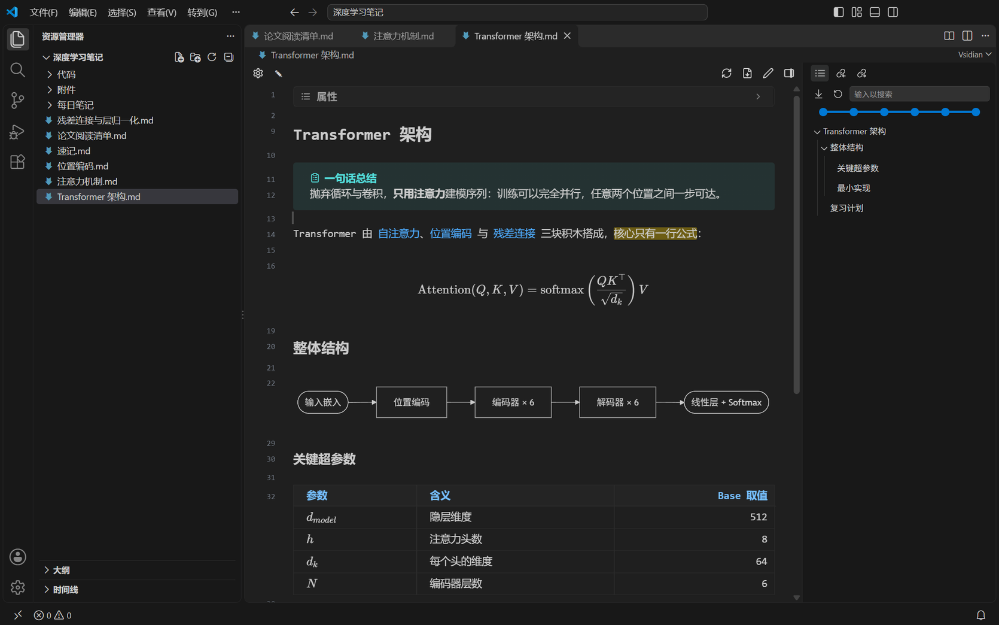
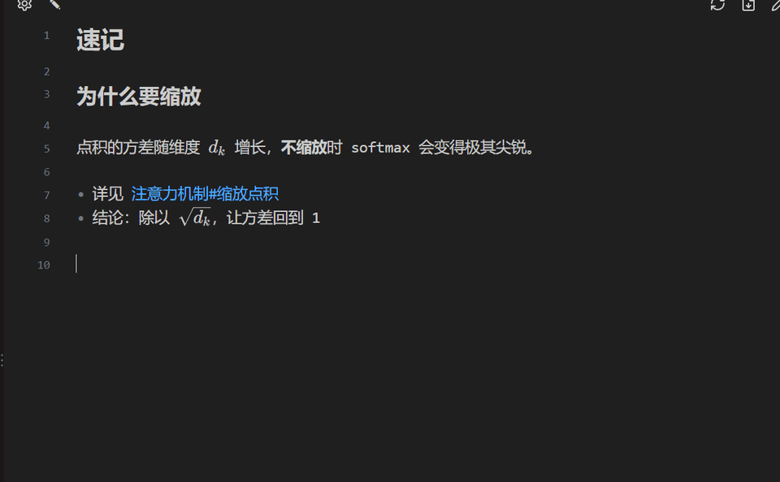
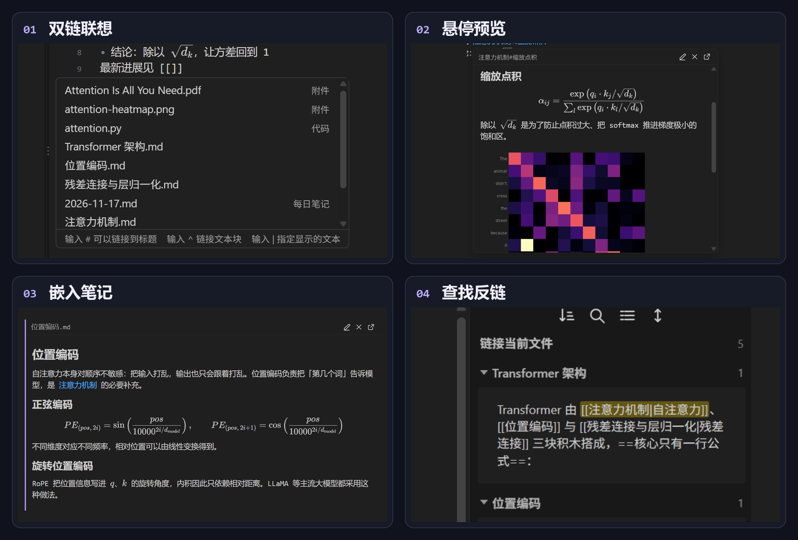
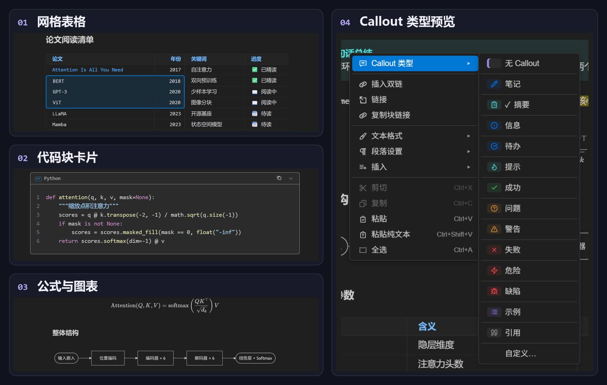
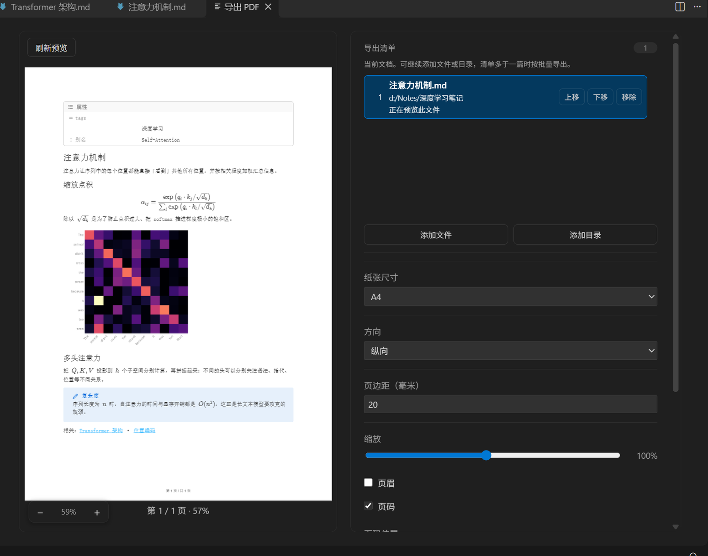
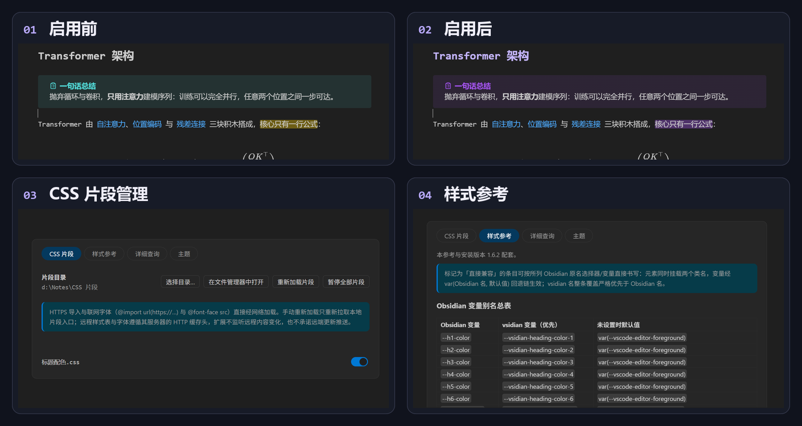

<div align="center">


# Vsidian

**像 Obsidian 一样写 Markdown，不用离开 VS Code**

[](https://marketplace.visualstudio.com/items?itemName=onegayi.vsidian)
[](https://code.visualstudio.com/)
[](https://github.com/ONEGAYI/vsidian/blob/main/LICENSE)

[安装](#安装) · [完整功能说明](https://github.com/ONEGAYI/vsidian/blob/main/docs/features.md) · [更新日志](https://github.com/ONEGAYI/vsidian/blob/main/CHANGELOG.md) · [English](https://github.com/ONEGAYI/vsidian/blob/main/README.en.md)

</div>



打开一个 `.md` 文件，就能在排好版的文档里直接编辑。光标移到标题、链接或公式上时，编辑器显示对应的 Markdown 源码；光标离开后，就恢复渲染。

从笔记里预览并修改另一篇笔记，或者把带公式和图表的文档导出成 PDF，都不必离开 VS Code。源文件仍是纯文本，照常保存、撤销和使用 Git 管理。

## 实时预览



- **三种视图随时切换**：实时预览、阅读、VSCode 原生源码编辑器，最近的模式和滚动位置跨窗口保留。
- **左侧文件管理器**：从编辑器工具栏打开左栏，浏览工作区、拖动文件移动、切换标签；按住 `Ctrl`（macOS 也可用 `⌘`）悬停可只读预览，不必打开标签。
- **只渲染屏幕附近的内容**：实时预览和阅读都按视口渲染，文档再长也不必一次绘制所有内容。
- **VSCode 的编辑习惯都在**：多光标、`Ctrl+D` 选中下一处、查找替换（支持正则）、`Ctrl+G` 跳转到行。
- **照顾中文写作**：`Ctrl+方向键` 按中文分词逐词移动，可选 jieba 引擎；界面提供中英文两种语言。

> **10 万行、8.9 MB 的测试文档**：从发出打开命令到完成第一次输入用时 671 毫秒，逐字输入平均 16.7 毫秒。1 千、1 万和 10 万行三个样本在初始和滚回页首时，实时预览都只挂载了 75 个正文 DOM 节点。
>
> <sub>2026-09 单机实测（Ryzen 7 9700X，VSCode 1.86.2），测量口径见[性能报告](https://github.com/ONEGAYI/vsidian/blob/main/docs/perf/2026-09-mvp-performance-summary.md)。</sub>

## 双链与引用

**笔记之间的链接，在 VSCode 里也能预览、跳转和修改。**



- **输入 `[[` 弹出候选**：覆盖笔记、图片、PDF 等常用文件；接着输入 `#` 或 `^`，列出目标笔记的标题和块。
- **按住 Ctrl 悬停预览**：笔记显示全文、章节或块，浮窗里可以直接编辑并保存；代码文件按 VSCode 原生配色显示，PDF 可以分页浏览。
- **`![[笔记]]` 嵌入另一篇笔记**：嵌入内容以卡片呈现，在卡片里修改会保存到原笔记，父文档不受影响。
- **反链与出链面板**：侧栏列出哪些笔记引用了当前笔记、当前笔记又链向哪里，点击即可定位到引用处。
- **改名自动更新引用**：在 VS Code 里重命名或移动文件时，Vsidian 可更新工作区中指向它的双链、普通链接和图片引用。

## 表格、Callout、公式与图表

**表格按网格编辑，Callout、公式和图表直接渲染。**



- **表格**：实时预览中可直接编辑单元格、跨格拖选复制，以及增删和拖动重排行列；引用块和列表里的表格同样适用。阅读模式也支持跨格选择和复制。
- **Callout**：用 `> [!note]` 添加提示块，也可以从右键菜单预览配色，在 13 种内置类型中选择。提示块支持折叠和嵌套，悬停预览、文档嵌入和 PDF 导出也会渲染。
- **公式与图表**：KaTeX 公式和 Mermaid 图表在两种视图里都直接渲染，图表可以全屏缩放，并导出为 SVG 或 PNG。
- **代码块**：以卡片呈现，带语言徽标、行号、复制和折叠按钮，语法配色跟随 VSCode 主题。
- **原生 HTML**：块级与行内 HTML、文档内的 `<style>`、`<details>`、音视频、iframe、SVG 与 MathML 都能在两种视图中渲染，脚本与危险属性会被净化。
- **frontmatter**：YAML 头显示为属性表，在浮层里增删改属性。

## PDF 导出

**导出之前，先在预览里看到真实的 PDF 页面。**



- 支持当前文档、当前选区、批量和合并四种导出方式。
- 导出窗口内置按打印尺寸显示的 PDF 预览，纸张、页边距、缩放、页眉页脚、页码和标题书签都可以调整。
- 排版与阅读视图同源，表格、公式、图表和嵌入内容都会进入 PDF。
- Remote SSH 远程工作区里同样可用，PDF 在本机生成并保存。

## 外观定制

**用 CSS 片段调整外观，Obsidian 的变量名可以照原样书写。**



- **CSS 片段**：在设置页「外观」里指定片段目录，逐个启停，支持 `@import`、HTTPS 远程样式与在线字体。
- **兼容 Obsidian 写法**：样式参考里标为「直接兼容」的 Obsidian 选择器和 CSS 变量，可以照原名书写。
- **样式参考随时查**：公开样式契约可以在设置页离线搜索，也能导出为 JSON，交给 AI 助手或其他工具使用。
- **快捷键全部可改**：所有操作集中改绑，支持两段键、冲突检测、清空与恢复默认。

## 附加组件

其他 VSCode 扩展可以声明为 Vsidian 附加组件，安装后由 Vsidian 自动发现。附加组件能够贡献设置页、输入行为、代码块渲染、粘贴转换规则、主题、命令、右键菜单项、工具栏按钮与面板；组件出错时，它的贡献会被自动撤下，不影响其他组件和内置功能。

安装 [Vsidian Agent Bridge](https://github.com/ONEGAYI/vsidian-agent-bridge) 后，在 Vsidian 里保留格式粘贴反重力（Antigravity）等来源的内容，可以还原行内公式（Vsidian 1.8.0 起）和块公式（Vsidian 1.9.0 与 Bridge 0.3.0 起）。

安装 [Vsidian Excalidraw](https://github.com/ONEGAYI/vsidian-excalidraw) 后，可以在 VS Code 和 Obsidian 中接着编辑同一份图档。搭配 Vsidian 1.10.0 或更新版本，笔记里的 `![[图档]]` 还能直接显示只读画板。

开发文档见 [附加组件开发指南](https://github.com/ONEGAYI/vsidian/blob/main/docs/addons/developer-guide.md)。当前稳定 API 为 1.7.0，兼容承诺自 1.1.0 起生效。

## 更多功能

| 编辑 | 链接与图片 | 界面与操作 |
| --- | --- | --- |
| 标题章节折叠 | 粘贴图片自动保存到指定目录 | 大纲面板：标题搜索、拖拽重排整节 |
| 富文本粘贴转 Markdown，分步撤销 | 拖动右下角手柄调整图片尺寸 | 正文统一右键菜单 |
| `Ctrl+Shift+V` 粘贴时保留原文 | 图片弹窗缩放、平移与导出原图 | 可读行宽滑块 |
| 任务勾选 | 可开启的外链预览卡片 | 悬停链接显示目标路径 |
| 列表与引用：`Enter` 续写、`Tab` 缩进 | 复制块链接 `[[笔记#^id]]` | `.md` 默认编辑器被占用时提示改回 |
| 快速操作条一键套用格式 | `[文字](note.md:103)` 跳到指定行 | 工具栏一键刷新图片与图表 |

完整的功能行为、边界与全部设置项见 [docs/features.md](https://github.com/ONEGAYI/vsidian/blob/main/docs/features.md)（中文）。

## 安装

**扩展市场（推荐）**：在 VS Code（1.82.3 及以上）的扩展面板搜索 **Vsidian**，或打开 [Marketplace 页面](https://marketplace.visualstudio.com/items?itemName=onegayi.vsidian)，安装后重新加载窗口。

**VSIX 手动安装**：从 [GitHub Releases](https://github.com/ONEGAYI/vsidian/releases) 下载 `vsidian-*.vsix`，在命令面板执行「Extensions: Install from VSIX…」并选择该文件，然后重新加载窗口。使用 Remote SSH 时，将同一个 VSIX 安装到远端扩展宿主。

安装完成后，打开任意 `.md` 文件即进入实时预览。

## 已知限制

- 不支持 Obsidian 的 Canvas、白板与 `.md` 之外的笔记格式；不兼容 Obsidian 插件本体，Vsidian 使用自己的附加组件体系。
- CSP 允许任意 https 图源。这是支持远程图床的设计代价，理论上可能被用作跟踪像素。
- 超长代码块跳过语法着色，以纯文本卡片显示。
- 从工作区搜索、问题面板等外部入口打开笔记时，不会自动定位到匹配处。这是 VSCode 公开 API 的缺口（跟踪 vscode#289785），可以用命令「定位到搜索选中结果」手动定位。

## 从源码构建

```bash
npm install              # 安装锁定依赖
npm run compile          # esbuild 构建 + tsc 类型检查
npm run test:unit        # 单元测试（无 VSCode 宿主依赖）
npm run test:browser     # Playwright 浏览器回归（首次需 npx playwright install chromium）
npm run test:integration # 真实 VSCode 宿主集成测试
npm run release:check    # 打包 VSIX 与发布前检查
```

Windows 上集成测试默认在独立桌面启动真实 VSCode 宿主，不干扰当前桌面；无人值守环境的前台模式与分片运行见 `test/integration/` 各启动器说明。发布流程、包体红线与样式契约门禁的约定见仓库内技能文档（`.agents/skills/release/` 与 `.agents/skills/style-contract/`）。

问题反馈请到 [Issues](https://github.com/ONEGAYI/vsidian/issues)，版本历史见 [CHANGELOG](https://github.com/ONEGAYI/vsidian/blob/main/CHANGELOG.md)。
