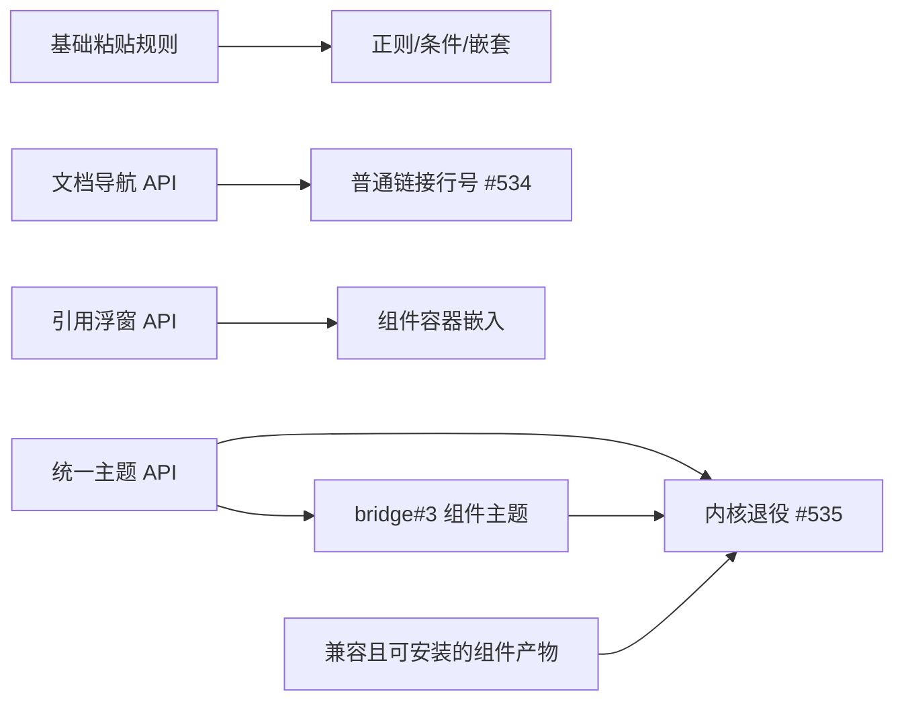

# 附加组件 API 扩展与 Codex 迁移批次

## 状态与计数

2026-10-15 用户批准：四张规格/父票 + 八张实施票，共十二张；旧票 #530–#533 改造为规格/父票，#534/#535 保留为实施票，新增六张实施票。四份规格已由访谈共识定稿，新旧票据均按下表登记并互链。代码尚未实施，规格完成、自动化与用户验收分别记账。

## 四份规格与父票

| 父票 | 正式规格 | 实施切片 |
| --- | --- | --- |
| [#530](https://github.com/ONEGAYI/vsidian/issues/530) | [声明式粘贴转换](addon-paste-conversion.md) | T01 / T02 |
| [#531](https://github.com/ONEGAYI/vsidian/issues/531) | [文档导航与普通链接行号](addon-navigation.md) | T03 / T04 |
| [#532](https://github.com/ONEGAYI/vsidian/issues/532) | [只读引用视图](addon-reference-views.md) | T05 / T06 |
| [#533](https://github.com/ONEGAYI/vsidian/issues/533) | [统一主题与内核退役](addon-themes.md) | T07 / T08 |

父票链接规格、实施票及验收进度，保持开放；规格定稿不关闭功能需求。每张实施票包含完整纵向接线、测试、API 契约和文档更新，不另设仅补门禁或仅补测试的尾票。

## 实施清单与覆盖

| 切片 | Issue | 交付 | Blocked by | 故事 |
| --- | --- | --- | --- | --- |
| T01 | [#541](https://github.com/ONEGAYI/vsidian/issues/541) | [基础粘贴规则完整链路](addon-api-extension-tickets/t01-paste-registration.md) | 无 | P-U01–P-U06、P-U09–P-U11 |
| T02 | [#542](https://github.com/ONEGAYI/vsidian/issues/542) | [正则、条件和嵌套转换](addon-api-extension-tickets/t02-paste-expressions.md) | [#541](https://github.com/ONEGAYI/vsidian/issues/541) | P-U07/P-U08，复验基础 |
| T03 | [#543](https://github.com/ONEGAYI/vsidian/issues/543) | [组件文档打开与定位](addon-api-extension-tickets/t03-document-navigation.md) | 无 | N-U01–N-U07、N-U12 |
| T04 | [#534](https://github.com/ONEGAYI/vsidian/issues/534) | [普通链接尾部行号](addon-api-extension-tickets/t04-link-line-suffix.md) | [#543](https://github.com/ONEGAYI/vsidian/issues/543) | N-U08–N-U11，复验定位 |
| T05 | [#544](https://github.com/ONEGAYI/vsidian/issues/544) | [只读引用浮窗](addon-api-extension-tickets/t05-reference-popup.md) | 无 | R-U01–R-U07、R-U12 |
| T06 | [#545](https://github.com/ONEGAYI/vsidian/issues/545) | [组件容器只读嵌入](addon-api-extension-tickets/t06-reference-embed.md) | [#544](https://github.com/ONEGAYI/vsidian/issues/544) | R-U08–R-U11，复验只读 |
| T07 | [#546](https://github.com/ONEGAYI/vsidian/issues/546) | [统一主题完整链路](addon-api-extension-tickets/t07-theme-system.md) | 无 | H-U01–H-U08、H-U11 |
| T08 | [#535](https://github.com/ONEGAYI/vsidian/issues/535) | [Codex 内核退役与迁移](addon-api-extension-tickets/t08-codex-retirement.md) | [#546](https://github.com/ONEGAYI/vsidian/issues/546)、[bridge#3](https://github.com/ONEGAYI/vsidian-codex-bridge/issues/3)、可安装产物 | H-U09/H-U10/H-U12，复验主题 |

四份规格共 47 条用户故事：粘贴 11、导航 12、引用视图 12、主题 12；上表覆盖全部故事。T01/T03/T05/T07 在规格文档进入 main 后为初始可认领票，才加 ready-for-agent；其他票等待明确前置，不因所有票都已建立而提前认领。

## 依赖关系

bridge#3 不再以 #535 的移除动作为上游前置。它等待 T07 提供可消费主题接口；#535 反向等待 bridge#3 与安装证据，消除循环。组件仓库 bridge#1 的脚手架、bridge#3 的运行时/ELK 决策和 bridge#4 的分发工作仍由原票管理，不计入本仓库十二张票，也不由本次文档发布擅自执行组件发布。

bridge#2 的粘贴规则仍消费 #530 的实现；本文不额外改造该组件票或把它当作主题退役前置。

## 共同维护与验收口径

- 公共 API 声明、语义目录、生成参考、消费样例和覆盖映射随各实施票维护。历史兼容的显式重锚定须同 PR 独立说明，不改台账伪造发行。
- TDD 优先现有公开 SDK/生产控制器接缝，UI 断言落绘制层；输入/光标变更跑 browser，宿主路径跑真实宿主。长命令首次落日志和退出码，后续复核读报告。
- 呈现票执行 ui-patterns / style-contract；#535 另外执行 release 打包体积与包内容检查。当前仅发布规格，不生成未来实现或视觉已通过的证据。
- 各实施 PR 引用实施票，不用自动关闭语句关闭规格父票。父票在实施与整体验收记录齐全后收口，真实视觉/IME/物理鼠标待验按人工清单保留。
- 文档提交按仓库纯文档约定进入 main；本批代码实施仍走 PR 与对应必需检查，不继承文档豁免。
