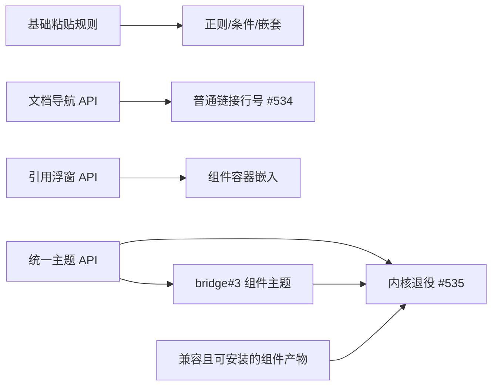

# 附加组件 API 扩展与 Codex 迁移批次

## 状态与计数

2026-10-15 用户批准：四张规格/父票 + 八张实施票，共十二张；旧票 #530–#533 改造为规格/父票，#534/#535 保留为实施票，新增六张实施票。T01/T03/T05/T07 已在组合分支实现，待用户整体验收；T02/T04/T06/T08 尚未实现。四份规格覆盖整个批次，当前四票交付不代表全部规格完成；规格父票保持开放，自动化与用户验收分别记账。

## 四份规格与父票

| 父票 | 正式规格 | 实施切片 |
| --- | --- | --- |
| [#530](https://github.com/ONEGAYI/vsidian/issues/530) | [声明式粘贴转换](addon-paste-conversion.md) | T01 / T02 |
| [#531](https://github.com/ONEGAYI/vsidian/issues/531) | [文档导航与普通链接行号](addon-navigation.md) | T03 / T04 |
| [#532](https://github.com/ONEGAYI/vsidian/issues/532) | [只读引用视图](addon-reference-views.md) | T05 / T06 |
| [#533](https://github.com/ONEGAYI/vsidian/issues/533) | [统一主题与内核退役](addon-themes.md) | T07 / T08 |

父票链接规格、实施票及验收进度，保持开放；规格定稿不关闭功能需求。每张实施票包含完整纵向接线、测试、API 契约和文档更新，不另设仅补门禁或仅补测试的尾票。

## 实施清单与覆盖

| 切片 | Issue | 交付 | Blocked by | 故事 |
| --- | --- | --- | --- | --- |
| T01 | [#541](https://github.com/ONEGAYI/vsidian/issues/541) | [基础粘贴规则完整链路](addon-api-extension-tickets/t01-paste-registration.md) | 无 | P-U01–P-U06、P-U09–P-U11 |
| T02 | [#542](https://github.com/ONEGAYI/vsidian/issues/542) | [正则、条件和嵌套转换](addon-api-extension-tickets/t02-paste-expressions.md) | [#541](https://github.com/ONEGAYI/vsidian/issues/541) | P-U07/P-U08，复验基础 |
| T03 | [#543](https://github.com/ONEGAYI/vsidian/issues/543) | [组件文档打开与定位](addon-api-extension-tickets/t03-document-navigation.md) | 无 | N-U01–N-U07、N-U12 |
| T04 | [#534](https://github.com/ONEGAYI/vsidian/issues/534) | [普通链接尾部行号](addon-api-extension-tickets/t04-link-line-suffix.md) | [#543](https://github.com/ONEGAYI/vsidian/issues/543) | N-U08–N-U11，复验定位 |
| T05 | [#544](https://github.com/ONEGAYI/vsidian/issues/544) | [只读引用浮窗](addon-api-extension-tickets/t05-reference-popup.md) | 无 | R-U01–R-U07、R-U12 |
| T06 | [#545](https://github.com/ONEGAYI/vsidian/issues/545) | [组件容器只读嵌入](addon-api-extension-tickets/t06-reference-embed.md) | [#544](https://github.com/ONEGAYI/vsidian/issues/544) | R-U08–R-U11，复验只读 |
| T07 | [#546](https://github.com/ONEGAYI/vsidian/issues/546) | [统一主题完整链路](addon-api-extension-tickets/t07-theme-system.md) | 无 | H-U01–H-U08、H-U11 |
| T08 | [#535](https://github.com/ONEGAYI/vsidian/issues/535) | [Codex 内核退役与迁移](addon-api-extension-tickets/t08-codex-retirement.md) | [#546](https://github.com/ONEGAYI/vsidian/issues/546)、[bridge#3](https://github.com/ONEGAYI/vsidian-codex-bridge/issues/3)、可安装产物 | H-U09/H-U10/H-U12，复验主题 |

四份规格共 47 条用户故事：粘贴 11、导航 12、引用视图 12、主题 12；上表是全部故事的实施规划。首轮仅交付 T01/T03/T05/T07，各故事实际覆盖见[API 覆盖映射](vsidian-addons-coverage.md)。后续票仍按前置结果认领，不能把本轮回归通过写成全部 47 条故事已实现。

## 依赖关系

bridge#3 不再以 #535 的移除动作为上游前置。它等待 T07 提供可消费主题接口；#535 反向等待 bridge#3 与安装证据，消除循环。组件仓库 bridge#1 的脚手架、bridge#3 的运行时/ELK 决策和 bridge#4 的分发工作仍由原票管理，不计入本仓库十二张票，也不由本次文档发布擅自执行组件发布。

bridge#2 的粘贴规则仍消费 #530 的实现；本文不额外改造该组件票或把它当作主题退役前置。

## 共同维护与验收口径

- 公共 API 声明、语义目录、生成参考、消费样例和覆盖映射随各实施票维护。历史兼容的显式重锚定须同 PR 独立说明，不改台账伪造发行。
- TDD 优先现有公开 SDK/生产控制器接缝，UI 断言落绘制层；输入/光标变更跑 browser，宿主路径跑真实宿主。长命令首次落日志和退出码，后续复核读报告。
- 呈现票执行 ui-patterns / style-contract；#535 另外执行 release 打包体积与包内容检查。实施证据只覆盖已交付切片，不生成未来实现或用户视觉已验收的结论。
- 各实施 PR 引用实施票，不用自动关闭语句关闭规格父票。父票在实施与整体验收记录齐全后收口，真实视觉/IME/物理鼠标待验按人工清单保留。
- 文档提交按仓库纯文档约定进入 main；本批代码实施仍走 PR 与对应必需检查，不继承文档豁免。

## 首轮组合实现与验证（2026-10-15）

组合分支为 `addon-api-batch`（[PR #548](https://github.com/ONEGAYI/vsidian/pull/548)）。T01 已在分支内，随后按 T03 → T05 → T07 真实合并，组合实施锚点为 `8cf6a681`；各票历史对象保持可达。后续补齐了组合测试的前置状态隔离、来源 B 文件基线，以及 T01 真实槽声明和整数优先级校验。当前候选 API 锚点为 `9c03461b`，重锚理由与失败证据见[API 门禁记录](addons-api-gate.md)。独立双轴审查与用户整体验收另行收口，不据此关闭规格父票。

以下日志位于联合工作树 `D:/CODE/Project/_Extensions/vsidian-addon-batch` 的 `out/test/addon-batch-takeover/`，只留本地，不随 VSIX 分发。结果按实际轮次记账，失败报告不覆盖：

| 检查 | 结果与证据 |
| --- | --- |
| 编译与生成产物 | 最终 `final-compile.log` exit 0；API 参考由生成器更新 |
| 全量单元与 Node 契约 | 静态用例清单登记修复后，367 文件 / 8300 项 Vitest 通过（`full-unit-fixed.log`）；Node 契约 188 通过、7 项桌面专项初次跳过；后以默认 desktop 补跑 `testHost.test.mjs` 33/33、0 跳过（`final-desktop-testHost.log`），覆盖原 7 项。T01 后续校验修复红 5 项 → 定向 74/74 绿（`t01-registration-contract-red.log` / `t01-registration-contract-green.log`） |
| 全量浏览器 | 全量 102 套中 101 通过，唯一 `languageSwitch` 漏登记合法主题查询，修复后定向通过（`full-browser.log` / `full-browser-language-fixed.log`，报告 `browser-runs/run-Kdo10W` / `run-tZw2Yg`）；T05 夹具改为显式开面板后，引用浏览器定向通过（`t05-explicit-panel-browser.log`，`run-KX6rhg`） |
| 全量真实宿主 | `all` 组四片首轮 423/430 通过；隔离夹具面板、事件缓存和渲染首选后，二轮 429/430。唯一来源 B 失败经状态证实为前序目录 move 清理删除 `sub`；本例重建两个自有目标后，先验证目录 move → 来源 B 两例，再完整重跑分片 1 的 108 项全绿。分片 2–4 的 322 项二轮已全绿，本次未改其执行代码；430 项全部取得 PASS。证据：`integration-first-run/`、`integration-second-run/`、`integration-with-predecessors.log`（37/37）、`integration-directory-predecessor.log`（2/2）、`full-integration-s1-fixed.log`（108/108） |
| T01 宿主历史链 | `final-t01-real-host.log` exit 0：真实组件登记、已开/新开双面板广播、纯文本旁路、两阶段 Undo/Redo、停用回收与重启登记 |
| 样式与 API 门禁 | `final-style-baseline.log` / `final-style.log`：历史样式基线复验及 8 项检查通过；`final-api-reference.log`、`final-api-baseline.log` / `final-api-compat.json`：生成新鲜度、候选锚点可信复验及 10 项兼容检查通过 |
| 文件树 | `final-tree.log` strict 通过；未新增第二份文件树或手写生成参考 |

样式旧契约固定于 v0.4.0（`75c3df79074bdeaec0f02a38d40124f0cd66f857`），组合前目标分支清单对象另存 `style-before-merges.json`；保留既有浮窗选择器和变量，设置页沿用原位置与控件档位。自动化运行的是开发态宿主，安装态 T16 与 Remote SSH T17 按既有阶段门控跳过，本轮未执行 VSIX 安装或 SSH 矩阵。

人工待验继续由[人工验证清单](manual-verification.md)和各规格实施段承载，以下项目仍未由用户验收：

- T01：真实来源内容的粘贴结果、纯文本选择，以及物理键盘操作下的两阶段撤销手感。
- T03：实际组件控件打开 Markdown / 原生文本、保留目标模式，及引用 B 内相对路径导航的使用体验。
- T05：真实按钮/文字旁的浮窗位置、鼠标联合域保活、键盘进入与 Esc 归还焦点，递归内容只读。
- T07：主题单选与来源标识、真实 VSCode 重启回显、跟随系统与固定 VSCode 主题的明暗行为、高对比可读性。Codex 内核继续保留，替代组件分发与退役不在本轮完成范围。
